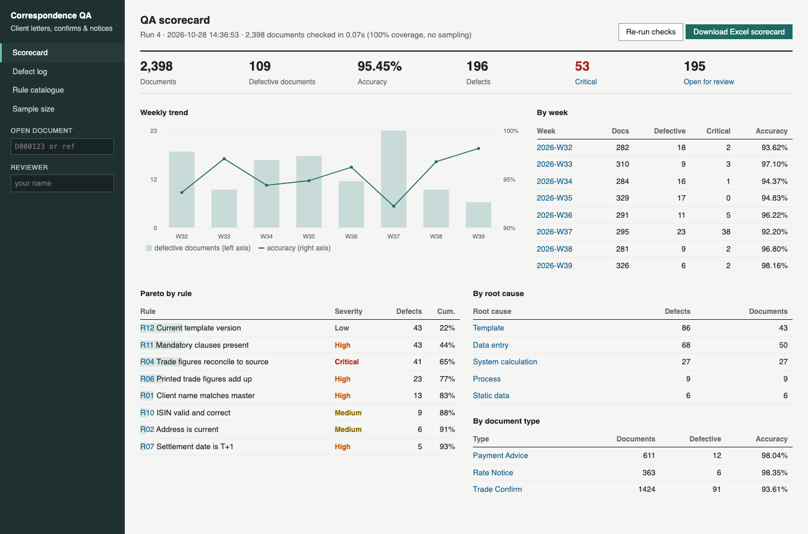
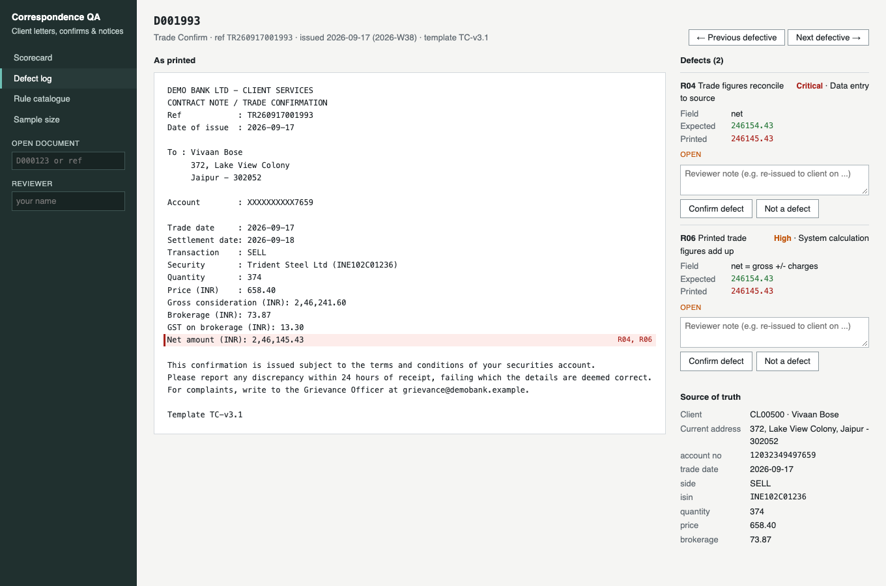

# Client Correspondence QA

Automated quality assurance for the letters a bank sends its clients: **trade confirmations, payment advices and interest-rate change notices**. Every document is read back, reconciled field-by-field to the source system, and checked against 13 format and regulatory rules. Defects are logged with a severity and a root cause, reviewed by an analyst, and rolled up into a weekly scorecard and an Excel MI pack.



## Why

Manual QA checks a sample. At a 4% error rate and ±2% precision, a reviewer would need to check about 166 of 300 documents in a week, and would still rarely see the low-frequency critical errors (an unmasked account number, a short notice period). This tool checks **100% of documents in well under a second** and leaves the analyst to review the exceptions.

## Results on the sample data

Eight weeks of synthetic correspondence (2,398 documents), with 109 documents carrying seeded defects:

```
$ python -m commsqa run
Run 1: 2,398 documents, 196 defects in 0.07s
Accuracy 95.45% | defective documents 109 | critical 53

Self-test against seeded defects: 100% caught, 0 clean documents flagged
```

| Seeded defect | Caught by | Seeded | Caught |
| --- | --- | --- | --- |
| Old template missing the 24-hour discrepancy clause | R11 Mandatory clauses | 43 | 43 |
| GST computed at 15% after a bad config release | R04 Trade figures reconcile | 18 | 18 |
| Client name misspelt | R01 Name matches master | 13 | 13 |
| Invalid ISIN check digit | R10 ISIN valid | 9 | 9 |
| Transposed digits in an amount | R04 / R05 Amount reconciles | 8 | 8 |
| Old address printed | R02 Address is current | 6 | 6 |
| Settlement at T+2 instead of T+1 | R07 Settlement date | 5 | 5 |
| Full account number printed | R03 Account masked | 4 | 4 |
| Rate change with < 30 days' notice | R13 Notice period | 3 | 3 |
| Wrong currency on a payment | R08 Currency matches | 2 | 2 |
| Value date on a weekend | R09 Value date valid | 1 | 1 |

The weekly trend shows the two incidents built into the data: the old-template problem in **W32–W35** that stops after the fix, and the GST spike in **W37** (accuracy drops to 92.2%, with 38 critical defects that week).

## Rules

| Code | Check | Severity | Root cause |
| --- | --- | --- | --- |
| R01 | Client name matches master | High | Data entry |
| R02 | Address is current (not from address history) | Medium | Static data |
| R03 | Account number masked to last 4 digits | Critical | System calculation |
| R04 | Trade quantity, price, gross, brokerage, GST, net reconcile to the booked trade | Critical | Data entry |
| R05 | Payment amount reconciles to the instruction | Critical | Data entry |
| R06 | Printed trade figures add up (gross = qty × price, GST 18%, net) | High | System calculation |
| R07 | Trade date matches; settlement is T+1 business day | High | Process |
| R08 | Payment currency matches | Critical | Data entry |
| R09 | Value date matches and is a business day | Medium | Process |
| R10 | ISIN passes its check digit and matches the trade | Medium | Data entry |
| R11 | All mandatory clauses for the document type are printed | High | Template |
| R12 | Produced from the current template version | Low | Template |
| R13 | Rate change effective at least 30 days after notice | Critical | Process |

## Web app

```bash
python -m commsqa serve      # http://localhost:5002 (builds the sample data on first start)
```

- **Scorecard:** KPIs, weekly trend chart, Pareto by rule, breakdown by root cause and document type, one-click re-run, Excel download
- **Defect log:** filter by week, document type, severity, root cause, rule and review status
- **Document review:** the letter as printed with defective lines highlighted, expected vs printed values, the source-of-truth record, and *Confirm / Not a defect* buttons with a reviewer note. Decisions survive re-runs; rejected defects drop out of accuracy
- **Rule catalogue** and a **sample-size calculator** (attribute sampling with finite-population correction) to compare manual sampling with full automation



## Quick start

```bash
python -m venv .venv && source .venv/bin/activate    # Windows: .venv\Scripts\activate
pip install -r requirements.txt

python -m commsqa run         # QA all documents, print the self-test, write reports/qa_scorecard.xlsx
python -m commsqa serve       # web app
python -m commsqa generate --seed 9 --weeks 12    # fresh synthetic data
pytest -q                     # 9 tests
```

The **Excel scorecard** (`reports/qa_scorecard.xlsx`) has a Summary sheet, a Weekly trend sheet with native Excel bar and line charts, a Pareto sheet with a chart, and a filterable, frozen-header Defect log.

[`docs/UAT_test_script.md`](docs/UAT_test_script.md) is the user-acceptance test script for the template change, with each scenario mapped to the rule or automated test that covers it.

## How it works

```
source tables (SQLite)          documents (rendered text)
clients, address history,  -->  trade confirms, payment advices,
accounts, trades, payments,     rate notices  (+ seeded defects)
rate notices, securities                 |
        |                                v
        |                        extract(): parse "Label : value" lines,
        |                        address block, ISIN, currency, template
        v                                |
   source_for(doc)  ------------>  13 rules  --> defects (severity, root cause,
                                                  field, expected, printed)
                                                       |
                         analyst review (confirm / reject, note) <--+
                                                       |
                       scorecard: KPIs, weekly trend, Pareto, Excel MI
```

- Amounts are handled with `Decimal` and printed in Indian digit grouping (`2,46,145.43`), then parsed back.
- Settlement uses a business-day calendar (weekends plus fixed national holidays).
- ISINs are validated with the standard letters-to-digits + Luhn check.

## Project structure

```
client-comms-qa/
├── commsqa/
│   ├── generate.py       # synthetic source data, documents, seeded defects and incidents
│   ├── doc_templates.py  # document templates (current and outdated versions) and clauses
│   ├── rules.py          # field extraction and the 13 QA rules
│   ├── qa.py             # run engine, review carry-over, MI queries, sample size
│   ├── scorecard.py      # Excel workbook with native charts (openpyxl)
│   ├── money.py          # Decimal, Indian number format, business days, ISIN check digit
│   ├── db.py             # SQLite schema
│   ├── web.py            # Flask app
│   ├── templates/, static/
│   └── cli.py
├── docs/                 # screenshots, UAT script
├── reports/              # Excel scorecard from the last run
└── tests/
```

All clients, accounts, securities and the bank ("Demo Bank Ltd") are fictional.
